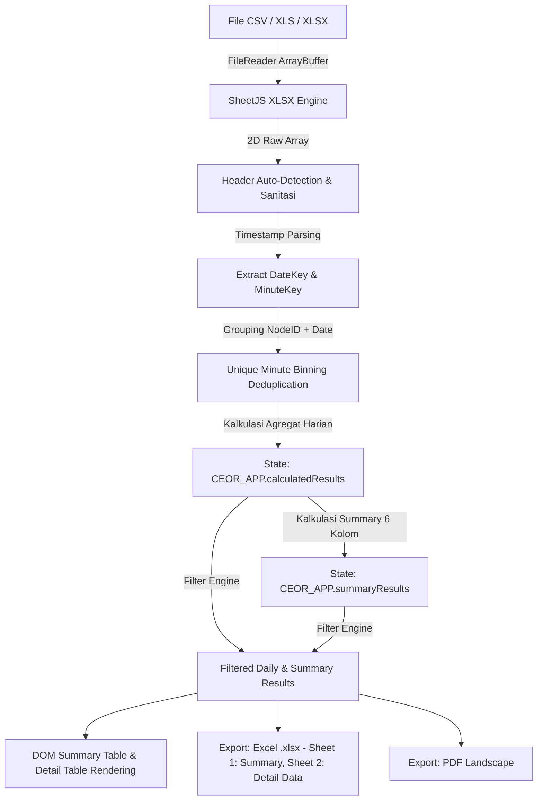

# Dokumentasi Teknis Proyek (project.md)

Dokumen spesifikasi arsitektur teknis, alur pemrosesan data, struktur modul, dan riwayat perbaikan sistem pada aplikasi **CEOR Data Dashboard**.

---

## 1. Arsitektur Sistem

Aplikasi dirancang dengan pola *Client-Side Single Page Application* (SPA) tanpa ketergantungan runtime backend. Seluruh proses parsing file, transformasi data, kalkulasi statistik, serta rendering dilakukan langsung pada memori browser via JavaScript ES6+.



---

## 2. Manajemen State (`CEOR_APP`)

State aplikasi disimpan terpusat dalam objek global `CEOR_APP`:

```javascript
const CEOR_APP = {
    // Seluruh record mentah hasil parsing file
    rawRecords: [
        {
            nodeId: string,      // Contoh: "8D-47E2EXT"
            rawDate: string,     // Nilai mentah tanggal/waktu
            dateKey: string,     // Format: "YYYY-MM-DD"
            minuteKey: string,   // Format: "YYYY-MM-DD HH:mm"
            pressure: number | null,
            flow: number | null
        }
    ],

    // Hasil ringkasan agregasi per NodeID dan DateKey (Harian)
    calculatedResults: [
        {
            nodeId: string,
            tgl: string,         // "YYYY-MM-DD"
            totalData: 1440,     // Konstanta target menit harian
            goodData: number,    // Menit unik valid (maks 1440)
            goodPressure: number,// Menit unik dengan pressure valid
            goodFlow: number,    // Menit unik dengan flow valid
            pressAvail: number,  // Availability parameter pressure (%)
            flowAvail: number,   // Availability parameter flow (%)
            avgPressure: number | null,
            avgFlow: number | null,
            availability: number,// 0.00 s/d 100.00%
            press1: 1 | "NULL",
            flow1: 1 | "NULL"
        }
    ],

    // Data harian aktif yang lolos kriteria filter pengguna
    filteredResults: [],

    // Data ringkasan per Node & Periode/Bulan (6 Kolom)
    summaryResults: [
        {
            nodeId: string,
            periode: string,     // Contoh: "Agustus 2026"
            monthKey: string,    // "YYYY-MM"
            totalHari: number,
            availability: number,// Rata-rata availability (maks 100%)
            acceptPress: number, // Jumlah hari status Pressure >= 90%
            acceptFlow: number   // Jumlah hari status Flow >= 90%
        }
    ],

    // Data ringkasan aktif yang lolos kriteria filter pengguna
    filteredSummaryResults: [],

    // Kondisi filter saat ini
    filters: {
        nodeId: '',
        startDate: '',
        endDate: ''
    }
};
```

---

## 3. Alur Pemrosesan Data (*Data Pipeline*)

### Tahap 1: Pembacaan File (`readSingleFile`)
1. Mengonversi file input menjadi `Uint8Array` via `FileReader.readAsArrayBuffer()`.
2. `XLSX.read` membedah struktur file (CSV, XLS, XLSX) dengan opsi `{ cellDates: true }`.
3. Membaca lembar kerja pertama dan mengonversi baris ke array 2D via `XLSX.utils.sheet_to_json(worksheet, { header: 1 })`.

### Tahap 2: Deteksi Header Otomatis (`detectHeaderColumns`)
Mencocokkan nama kolom secara fleksibel terhadap variasi penamaan umum:
- **NodeID**: `nodeid`, `node`, `wellname`, `well`.
- **Tanggal**: `tanggal`, `tgl`, `date`, `datetime`, `scantime`, `timestamp`, `time`.
- **Pressure**: `pressure`, `press`, `tekanan`, `pressure1`, `press1`.
- **Flow**: `flow`, `flowrate`, `debit`, `flow1`.

### Tahap 3: Ekstraksi Timestamp Menit (`extractDateTimeKeys`)
Mendukung format `Date` objek, `M/D/YYYY H:m`, `DD/MM/YYYY H:m`, dan `YYYY-MM-DD HH:mm:ss`. Menghasilkan dua penanda kunci:
- `dateKey`: Penanda agregasi harian (`YYYY-MM-DD`).
- `minuteKey`: Penanda deduplikasi interval menit (`YYYY-MM-DD HH:mm`).

### Tahap 4: Deduplikasi & Agregasi Menit Unik (`recalculateCEOR`)
Untuk mengatasi masalah duplikasi data lintas file:
1. Data dikelompokkan ke Map berdasarkan `nodeId||dateKey`.
2. Setiap grup memiliki struktur `minuteBins: Map<minuteKey, { pressure, flow }>`.
3. Hanya data dengan pembacaan telemetri valid (`pressure !== null` atau `flow !== null`) yang dimasukkan ke `minuteBins`.
4. Jika terdapat beberapa baris data pada menit yang sama, data digabungkan (saling melengkapi jika ada field bernilai null) tanpa menambah jumlah baris menit.
5. Nilai rata-rata dihitung dari data unik per menit.

---

## 4. Riwayat Masalah & Solusi Teknis (*Bug Fixes*)

### Masalah 1: Loading Spinner Macet (*Infinite Overlay*)
- **Gejala**: Indikator loading tetap menutupi antarmuka walau data telah selesai dihitung.
- **Penyebab**: Elemen loader diberi class Bootstrap `.d-flex` yang memiliki deklarasi `display: flex !important`. Pemanggilan `loader.style.display = 'none'` kalah prioritas spesifisitas CSS terhadap `!important`.
- **Solusi**: Mengganti mekanisme buka/tutup overlay menggunakan manipulasi class utilitas Bootstrap `loader.classList.remove('d-flex'); loader.classList.add('d-none');` (karena `.d-none` juga menggunakan `display: none !important`).

### Masalah 2: Input File Terbaca Kosong Saat Pemrosesan Async
- **Gejala**: Muncul peringatan *"Tidak ada data valid yang dapat diproses"* saat file diunggah.
- **Penyebab**: Koleksi `event.target.files` adalah objek hidup (*live reference*). Perintah `event.target.value = ''` langsung menghapus isi `files` sebelum fungsi `async processFiles()` sempat membaca byte file.
- **Solusi**: Menggandakan referensi file ke array statis menggunakan `Array.from(event.target.files)` sebelum mereset nilai elemen input.

### Masalah 3: Availability Melebihi 100% Akibat Duplikasi Baris
- **Gejala**: Persentase availability mencapai 196%+ ketika pengguna mengunggah beberapa file yang berisi timestamp tumpang-tindih.
- **Penyebab**: Penghitungan `good_data` sebelumnya didasarkan pada jumlah baris mentah (`rawRecords.length`), bukan jumlah menit unik bertarget 1.440.
- **Solusi**:
  - Menerapkan *Unique Minute Binning* berbasis `Map`.
  - Membatasi nilai `good_data = Math.min(uniqueValidMinutes, 1440)`.
  - Mencapping persentase availability: `Math.min(Math.max((goodData / 1440) * 100, 0), 100)`.
  - Memastikan rata-rata availability di seluruh dashboard tidak dapat melebihi 100.00%.

### Masalah 4: Sinkronisasi Filter Dropdown & Text Input
- **Gejala**: Pemilihan opsi pada dropdown Node ID tidak langsung memperbarui tabel tanpa menekan tombol terapkan.
- **Penyebab**: Event listener `change` pada elemen `#filterNodeIdSelect`, `#filterStartDate`, dan `#filterEndDate` belum terdaftar.
- **Solusi**: Mendaftarkan event listener reaktif pada input select dan date picker serta menyinkronkan pembersihan input teks pencarian saat dropdown dipilih (dan sebaliknya).

---

## 5. Manifes Fungsi Modul (`ceor.js`)

| Nama Fungsi | Lingkup & Tanggung Jawab |
| :--- | :--- |
| `initEventListeners()` | Pendaftaran event handler untuk upload, drag-drop, filter, clear, dan ekspor. |
| `handleFileUpload(event, isAppend)` | Normalisasi file input menjadi array statis dan delegasi ke processor. |
| `processFiles(files, isAppend)` | Orkestrasi asinkron pembacaan multi-file, perhitungan ulang, dan rendering UI. |
| `readSingleFile(file)` | Konversi buffer file spreadsheet/CSV menjadi array baris data via SheetJS. |
| `detectHeaderColumns(headerRow)` | Pemetaan indeks posisi kolom NodeID, Tanggal, Pressure, dan Flow secara otomatis. |
| `extractDateTimeKeys(rawVal)` | Parsing tanggal dan waktu menjadi pasangan `dateKey` dan `minuteKey`. |
| `parseNumeric(val)` | Sanitasi nilai angka, koma desimal, dan filter nilai kosong/NULL/NaN. |
| `recalculateCEOR()` | Engine agregasi CEOR, deduplikasi menit unik, pembatasan availability 100%. |
| `calculateSummaryResults(dailyRecords)` | Agregasi data ringkasan 6 kolom per Node ID dan Periode/Bulan (Total Hari, Availability, Accept Press, Accept Flow). |
| `formatPeriodeBulan(dateStr)` | Konversi format tanggal menjadi teks Periode/Bulan Bahasa Indonesia (misal: "Agustus 2026"). |
| `populateNodeIdDropdown()` | Pengisian opsi unik Node ID pada elemen select filter. |
| `applyFilters()` | Eksekusi filter data berdasarkan Node ID dan rentang tanggal aktif. |
| `resetFilters()` | Pengembalian kondisi seluruh kontrol filter ke kondisi default. |
| `renderSummaryTable()` | Pembuatan elemen DOM tabel ringkasan (Summary) 6 kolom. |
| `renderTable()` | Pembuatan elemen DOM tabel rincian data harian CEOR. |
| `updateSummaryCards()` | Pembaruan angka statistik ringkasan pada kartu dashboard utama. |
| `updateUIState()` | Pengaturan visibilitas elemen empty state vs section tabel hasil. |
| `clearAllData()` | Pembersihan total seluruh memori data mentah, kalkulasi harian, dan ringkasan. |
| `exportToExcel()` | Pembuatan dan pengunduhan file Excel `.xlsx` 2 Sheet: Sheet 1 "Summary" & Sheet 2 "Detail Data". |
| `exportToPDF()` | Pembuatan dan pengunduhan dokumen `.pdf` bertabel landscape. |
| `showLoading(isLoading, msg)` | Manajemen visibilitas overlay loading berbasis class Bootstrap. |
| `showNotification(msg, type)` | Penampil notifikasi toast informatif di sudut layar. |

---

## 6. Verifikasi & Pengujian Sistem

Pengujian otomatis dilakukan menggunakan Playwright pada dataset acuan `CEOR Data 12 Agust 2026.csv`:

1. **Uji Single Upload (8.548 baris mentah)**:
   - Total Node ID: 6
   - Total Hari: 1
   - Total Baris: 8.548
   - Good Data per node: 1.420 s/d 1.428 menit
   - Availability per node: 98,61% s/d 99,17%
   - Rata-rata Availability: 98,94%
   - Overlay status: Menutup sempurna (`display: none`).

2. **Uji Multi-File / Append Duplikat (17.096 baris mentah)**:
   - Total Baris Raw: 17.096
   - Good Data per node: Tetap 1.420 s/d 1.428 (tidak membengkak)
   - Availability per node: Tetap 98,61% s/d 99,17% (tidak melebihi 100%)
   - Rata-rata Availability: Tetap 98,94% (validasi capping & deduplikasi sukses).
